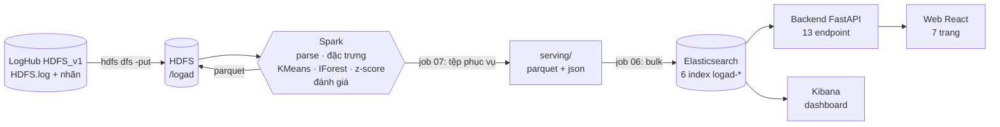

# LogAD – Phát hiện bất thường từ nhật ký hệ thống

Đồ án môn **Nhập môn Big Data** – **Đề tài 13: Phân tích dữ liệu nhật ký hệ thống để phát hiện bất thường**.

Hệ thống đọc **11,2 triệu dòng log HDFS** (bộ LogHub HDFS_v1), gom theo **block**, dùng **Spark** trích đặc trưng và chạy **phân cụm KMeans** cùng hai mô hình
đối chứng để tìm block có hành vi lạ, lưu kết quả vào **Elasticsearch** rồi hiển thị trên **web dashboard** và **Kibana** (thống kê lỗi + cảnh báo bất thường).

> Đối chiếu yêu cầu đề bài: dữ liệu log hệ thống ✅ · lưu trữ **HDFS** (log thô, dữ liệu trung gian, kết quả Spark) và **Elasticsearch** (kết quả truy vấn) ✅ ·
> Spark xử lý và trích đặc trưng ✅ · phân cụm (KMeans) và phát hiện bất thường (Isolation Forest, z-score) ✅ · dashboard thống kê lỗi và cảnh báo ✅.

## Mục lục
1. [Kết quả chính](#1-kết-quả-chính)
2. [Kiến trúc](#2-kiến-trúc)
3. [Dữ liệu](#3-dữ-liệu)
4. [Quy trình xử lý (7 job Spark)](#4-quy-trình-xử-lý-7-job-spark)
5. [Mô hình và cách đánh giá](#5-mô-hình-và-cách-đánh-giá)
6. [Lưu trữ: HDFS, Parquet, Elasticsearch](#6-lưu-trữ-hdfs-parquet-elasticsearch)
7. [Backend API](#7-backend-api)
8. [Giao diện web (7 trang)](#8-giao-diện-web-7-trang)
9. [Dashboard Kibana](#9-dashboard-kibana)
10. [Cấu trúc thư mục](#10-cấu-trúc-thư-mục)
11. [Cài đặt môi trường](#11-cài-đặt-môi-trường)
12. [Cách chạy](#12-cách-chạy)
13. [Cấu hình](#13-cấu-hình)
14. [Kiểm thử và lint](#14-kiểm-thử-và-lint)
15. [Hạn chế và điều cần nói thẳng](#15-hạn-chế-và-điều-cần-nói-thẳng)
16. [Quy trình phát triển](#16-quy-trình-phát-triển)
17. [Tài liệu khác và trích dẫn](#17-tài-liệu-khác-và-trích-dẫn)

---

## 1. Kết quả chính

Kết quả thật khi chạy pipeline trên **toàn bộ** HDFS_v1 (trên cụm HDFS + Spark trong Docker). Chấm trên **nửa test** của các block (287.162 block có nhãn,
trong đó 8.399 bất thường thật, 2,92 %):

| Mô hình | Loại | Precision | Recall | F1 | PR-AUC |
|---|---|---|---|---|---|
| **KMeans** (k = 5, Spark MLlib) | phân tán, không giám sát | 0,889 | 0,923 | **0,906** | 0,962 |
| Isolation Forest (scikit-learn) | một máy, không giám sát | 0,562 | 0,576 | 0,569 | 0,690 |
| Z-score số dòng WARN/ERROR | thống kê | 0,024 | 0,006 | 0,010 | 0,039 |

- KMeans bắt đúng **7.753 / 8.399** block bất thường, bỏ sót 646, báo nhầm 972 (0,35 % số block bình thường).
- Hệ thống gắn cờ **17.451 block (3,0 %)**. Con số này luôn gần 3 % vì ngưỡng điểm đặt ở phân vị 97; **không phải** số bất thường thật (thật: 16.838).
- Z-score yếu là kết quả đúng: HDFS_v1 chỉ có hai mức log INFO và WARN (không có ERROR/FATAL) và các lỗi quan trọng như `writeBlock … received exception` được ghi ở mức INFO.
- Các lần chạy khác nhau cho số lệch nhẹ (KMeans có thể chọn k = 5 hoặc 6, F1 0,904–0,906). Số ghi trong báo cáo phải là số trên trang **Mô hình** của lần chạy dùng để demo.

## 2. Kiến trúc



Ai đọc/ghi gì:

| Thành phần | Vai trò | Cổng |
|---|---|---|
| **HDFS** (namenode + datanode) | Lưu log thô, log đã parse, đặc trưng, kết quả mô hình, số liệu thống kê | 9870 (giao diện), 9000 |
| **Spark** (master + 1 worker 8 lõi) | Chạy job 01–07 | 8080 (giao diện), 7077 |
| **Elasticsearch** | Lưu kết quả để API và Kibana truy vấn nhanh | 9200 |
| **Kibana** | Dashboard thống kê lỗi và cảnh báo | 5601 |
| **Backend** (FastAPI) | REST API theo hợp đồng `api/openapi.yaml` | 8000 |
| **Web** (nginx + React) | Giao diện chính, tự chuyển `/api` sang backend | 3000 |

Backend có **ba nguồn dữ liệu** (`LOGAD_DATA_SOURCE`): `elasticsearch`, `files` (đọc thẳng tệp phục vụ, không cần Elasticsearch), `demo` (dữ liệu mô phỏng để phát triển giao diện).
Mặc định `auto` chọn theo thứ tự **Elasticsearch có dữ liệu → tệp phục vụ → dữ liệu mô phỏng**; `GET /api/v1/health` cho biết đang dùng nguồn nào.

## 3. Dữ liệu

**LogHub – HDFS_v1** ([github.com/logpai/loghub](https://github.com/logpai/loghub), [Zenodo 8196385](https://zenodo.org/records/8196385)):

| Mục | Giá trị (đã đếm trên bản tải về) |
|---|---|
| Số dòng log | 11.175.629 (1,58 GB) |
| Số block (`blk_…`) | 575.061 |
| Block bất thường (nhãn LogHub) | 16.838 (2,93 %) |
| Khoảng thời gian | 09/11/2008 20:35 → 11/11/2008 11:16 (UTC, log gốc không có múi giờ) |
| Mức log | INFO 10.812.836 · WARN 362.793 · không có ERROR/FATAL |

Một dòng log: `081109 203615 148 INFO dfs.DataNode$PacketResponder: PacketResponder 1 for block blk_38865049064139660 terminating`
(ngày `yyMMdd`, giờ `HHmmss`, pid, mức, component, nội dung).

**Block** là khối dữ liệu HDFS; mỗi block có một vòng đời gồm khoảng 19 dòng (cấp phát, nhận, lưu, xóa). Nhãn Normal/Anomaly của LogHub gán theo **block**, nên hệ thống
phân tích theo block: gom mọi dòng chứa cùng mã `blk_…` lại.

Tải dữ liệu (178 MB nén, giải nén ra ~1,6 GB) vào `data/raw/`:
```bat
python scripts/download_loghub.py            &:: bản đầy đủ: data/raw/HDFS.log và data/raw/preprocessed/anomaly_label.csv
python scripts/download_loghub.py --sample   &:: chỉ 2.000 dòng (HDFS_2k.log, không nhãn) để thử parser
```
Nếu chưa có bản đầy đủ, pipeline tự dùng `HDFS_2k.log` (không có nhãn nên bỏ bước đánh giá).

## 4. Quy trình xử lý (7 job Spark)

Mỗi job nằm trong `jobs/`, có hàm `run(spark, cfg)` và chạy được độc lập bằng `spark-submit`. Đường dẫn vào/ra suy ra từ `configs/pipeline.yaml` (chế độ `hdfs` hoặc `local`).

| Job | Việc | Đầu ra |
|---|---|---|
| **01** `01_ingest_to_hdfs.py` | Kiểm tra log thô đọc được, in quy mô (11.175.629 dòng, 575.061 nhãn) | – |
| **02** `02_parse_logs.py` | Parse bằng regex, **rút template** bằng cách che mã block, IP, đường dẫn, số; tách mỗi block của một dòng thành một hàng | `parsed/` (12,6 triệu hàng, 54 template) |
| **03** `03_extract_features.py` | Mỗi block thành một **vector đếm sự kiện** (54 chiều), chuẩn hóa `log1p · idf · L2`; thống kê dòng theo (cửa sổ 60 giây, component, mức) | `features/`, `window_stats/` |
| **04** `04_detect_anomalies.py` | Huấn luyện KMeans (chọn k), Isolation Forest, z-score; tìm đột biến lỗi theo thời gian | `results/{kmeans,iforest,zscore,spikes}`, `training.json` |
| **05** `05_evaluate.py` | Precision, Recall, F1, PR-AUC trên nửa test | `results/metrics.json` |
| **06** `06_index_elasticsearch.py` | Nạp tệp phục vụ vào 6 index Elasticsearch (bulk, theo lô) | Elasticsearch |
| **07** `07_export_serving.py` | Gom kết quả thành tệp nhỏ cho backend: bảng block, thống kê sự kiện, thống kê lỗi, đột biến, dòng log cần hiển thị, `meta.json` | `serving/` |

Mã dùng chung nằm ở `src/logad/`: `parsing` (che template, chạy giống nhau ở Python và Spark), `features`, `models/`, `evaluation`, `splits`, `storage`
(đọc/ghi Parquet và JSON, HDFS hoặc local), `serving`, `es_sink` + `es_load` (Elasticsearch), `spark_utils`, `config`.

## 5. Mô hình và cách đánh giá

| Mô hình | Cách hoạt động | Ngưỡng gắn cờ |
|---|---|---|
| **KMeans** (Spark MLlib, mô hình chính) | Gom block thành k cụm theo vector sự kiện. Điểm = khoảng cách tới tâm cụm gần nhất; block xa mọi cụm là bất thường | Phân vị 97 của điểm |
| **Isolation Forest** (scikit-learn, 200 cây) | Cô lập các block "lạ" dựa trên số lần mỗi sự kiện, số dòng, số WARN/ERROR, thời lượng | `contamination = 0,03` |
| **Z-score** (thống kê, không học) | z của số dòng WARN+ERROR trong block so với mọi block | z > 3 |

Hai mô hình đầu **học không giám sát**: nhãn không dùng khi huấn luyện. Quy trình đánh giá:
1. Chia block thành hai nửa **val** và **test** theo băm cố định của `block_id` (`src/logad/splits.py`).
2. **k của KMeans** được chọn bằng PR-AUC trên nửa **val** (có nhãn thì dùng; chưa có nhãn thì dùng `k_default`). Không chọn theo silhouette vì silhouette cao ở k lớn nhưng PR-AUC rất thấp.
3. **Chỉ số báo cáo** tính trên nửa **test**, nơi k chưa được chọn.

Lưu ý trung thực: cả ba mô hình được fit trên **toàn bộ** block (kể cả nửa test) nhưng không thấy nhãn; điều này khác với "huấn luyện trên tập train rồi thử trên tập chưa từng thấy".
PR-AUC và Precision/Recall được dùng thay cho Accuracy vì chỉ ~3 % block là bất thường.

## 6. Lưu trữ: HDFS, Parquet, Elasticsearch

**HDFS** (thư mục `/logad`, chế độ `hdfs` của pipeline):

| Đường dẫn | Nội dung | Kích thước |
|---|---|---|
| `/logad/raw` | `HDFS.log` (1,5 GB, 13 block 128 MB), `anomaly_label.csv` | 1,5 GB |
| `/logad/parsed` | Parquet, mỗi dòng log đã parse (mỗi block một hàng) | ~330 MB |
| `/logad/features` (+ `features_meta.json`) | Parquet, một hàng/block: vector đếm sự kiện | ~22 MB |
| `/logad/window_stats` | Số dòng theo (cửa sổ 60 giây, component, mức) | ~60 KB |
| `/logad/results` | Điểm và dự đoán của 3 mô hình, `metrics.json`, `training.json`, `spikes` | ~29 MB |

**Elasticsearch** (6 index, tiền tố `logad`, nạp bằng job 06):

| Index | Số tài liệu | Nội dung | Dùng cho |
|---|---|---|---|
| `logad-anomalies` | 575.061 | Mỗi block một tài liệu: điểm + cờ 3 mô hình, cụm, nhãn thật, `top_events`, `counts` | Danh sách và chi tiết block, phân bố điểm |
| `logad-logs` | ~805 nghìn | Dòng WARN/ERROR/FATAL + mọi dòng của block bị KMeans/IForest gắn cờ | Tìm kiếm log, chuỗi sự kiện |
| `logad-error-stats` | ~10 nghìn | Số dòng theo (cửa sổ 60 giây, component, mức) | Biểu đồ theo thời gian, thành phần sinh lỗi |
| `logad-spikes` | 155 | Đột biến lỗi theo z-score | Cảnh báo |
| `logad-events` | 54 | Thống kê từng mẫu sự kiện (số lần, số block, độ nghiêng) | Trang Sự kiện |
| `logad-meta` | 1 | Tổng quan lần chạy, ngưỡng, chỉ số mô hình, từ vựng sự kiện | Meta, trang Mô hình |

Mapping được khai báo tường minh trong `src/logad/es_sink.py` (không để Elasticsearch tự đoán kiểu). Xem nhanh: http://localhost:9200/_cat/indices/logad-*?v

**Tệp phục vụ** (`serving/`, job 07 ghi, luôn là thư mục cục bộ): `meta.json`, `blocks.parquet`, `events.parquet`, `window_stats.parquet`, `spikes.parquet`, `lines/`.
Đây là nguồn cho job 06 và cho chế độ `files` của backend. Thời gian luôn lưu dạng giây Unix (UTC) để không lệch múi giờ giữa Spark, pandas và trình duyệt.

## 7. Backend API

FastAPI + pydantic, theo **API-first**: [`api/openapi.yaml`](api/openapi.yaml) là hợp đồng gốc, backend và frontend cùng bám theo; test tự kiểm tra backend khớp hợp đồng.
Swagger: http://localhost:8000/docs (khi chạy ngoài Docker) hoặc qua web `http://localhost:3000/api/v1/...`.

| Endpoint | Việc |
|---|---|
| `GET /api/v1/health`, `/meta` | Trạng thái, nguồn dữ liệu, khoảng thời gian, lần chạy pipeline |
| `GET /overview/summary`, `/overview/timeline?bucket=`, `/overview/components` | Tổng quan, biểu đồ theo thời gian (1 phút – 1 giờ), thành phần sinh lỗi |
| `GET /alerts` | Cảnh báo: đột biến lỗi + block điểm cao nhất |
| `GET /anomalies`, `/anomalies/export`, `/anomalies/{block_id}` | Danh sách (lọc, sắp xếp, phân trang), xuất CSV, chi tiết + lý do |
| `GET /events` | Thống kê mẫu sự kiện |
| `GET /models`, `/models/{model}/score-distribution` | Chỉ số mô hình, phân bố điểm |
| `GET /logs` | Tìm kiếm log |

Code: `backend/app/` (`routes.py`, `schemas.py`, `repositories/`). Router chỉ phụ thuộc giao diện `Repository`; `elastic.py`, `files.py`, `demo.py` là ba cách hiện thực,
phần logic dùng chung (lý do bất thường, cảnh báo, đánh giá mô hình) ở `repositories/common.py`.

## 8. Giao diện web (7 trang)

React + TypeScript + Vite; kiểu dữ liệu sinh tự động từ `openapi.yaml` (`npm run gen:api`). Phong cách phẳng, có chế độ sáng/tối, dùng được trên điện thoại. Giờ hiển thị là UTC.

| Trang | Đường dẫn | Trả lời câu hỏi | Các số chính |
|---|---|---|---|
| Tổng quan | `/` | Tình hình chung ra sao? | Block bị gắn cờ, dòng ERROR+FATAL, số cảnh báo, tổng dòng; biểu đồ lỗi theo thời gian (đỉnh lỗi, hai cụm bất thường A1/A2); thành phần sinh lỗi |
| Bất thường | `/anomalies` | Block nào bị nghi? | Điểm so với ngưỡng, cụm KMeans, số dòng, cơ cấu WARN/ERROR, sự kiện nổi bật; lọc theo mô hình, điểm tối thiểu, mã block; xuất CSV |
| Chi tiết block | `/anomalies/{block_id}` | Vì sao block này bị nghi? | Điểm 3 mô hình, nhãn thật, "Có" so với "Thường" của từng sự kiện lệch, dải thời gian, toàn bộ chuỗi sự kiện |
| Cảnh báo | `/alerts` | Có gì cần chú ý ngay? | Đột biến lỗi (z-score; z ≥ 8 là nghiêm trọng), block điểm cao; ma trận lỗi component × mức |
| Sự kiện | `/events` | Sự kiện nào hay đi cùng bất thường? | Số lần, số block, % nằm trong block bị gắn cờ, độ nghiêng (lift) |
| Mô hình | `/models` | Mô hình nào tốt, đến đâu? | Precision/Recall/F1/PR-AUC, ma trận nhầm lẫn, tham số, ngưỡng, phân bố điểm |
| Nhật ký | `/logs` | Cho tôi xem dòng log gốc | Tìm theo nội dung, mức, component, block, thời gian |

Giải thích số liệu trên giao diện:
- **Điểm và ngưỡng**: điểm càng cao càng lạ; vượt ngưỡng thì bị gắn cờ.
- **Độ nghiêng (lift)** = tỉ lệ lần xuất hiện nằm trong block bị gắn cờ chia cho mức chung (~2,7 %); 100 % ứng với ×37,3. Tính theo cờ của KMeans nên **không phải bằng chứng độc lập**.
- **Cảnh báo đột biến** "7 dòng WARN/ERROR trong 60 giây (trung bình 0,42, z = 6,4)": trung bình là mức nền mỗi phút của component, z là số độ lệch chuẩn so với mức nền.
- Dòng ERROR + FATAL bằng **0** là đúng với dữ liệu này.

## 9. Dashboard Kibana

Dashboard **"LogAD – Thống kê lỗi và cảnh báo bất thường"** gồm 10 panel (4 số lớn, WARN theo thời gian, component sinh nhiều WARN nhất, block bất thường theo thời gian,
phân bố điểm KMeans theo nhãn thật, mô hình nào gắn cờ, hai bảng top). Sinh bằng mã để tái tạo được:

```bat
python dashboard/kibana/build_saved_objects.py
curl -X POST -H "kbn-xsrf: true" --form file=@dashboard/kibana/saved_objects/dashboard.ndjson "http://localhost:5601/api/saved_objects/_import?overwrite=true"
```
Mở: http://localhost:5601/app/dashboards#/view/logad-dashboard. Chi tiết trong [`dashboard/kibana/README.md`](dashboard/kibana/README.md).

## 10. Cấu trúc thư mục

```
api/openapi.yaml        hợp đồng API (nguồn sự thật duy nhất)
backend/                FastAPI: app/ (routes, schemas, repositories), tests/
frontend/               React + Vite + TypeScript (src/pages, src/components), kiểu API sinh từ openapi.yaml
configs/pipeline.yaml   cấu hình trung tâm của pipeline (đường dẫn, tham số mô hình, Spark, Elasticsearch)
src/logad/              thư viện pipeline: parsing, features, models/, evaluation, storage, serving, es_*, spark_utils
jobs/                   7 job Spark theo thứ tự 01 → 07
scripts/                tải dữ liệu, chạy pipeline local/cụm, đưa dữ liệu lên HDFS, submit job, sinh dữ liệu mô phỏng
dashboard/kibana/       sinh và nạp dashboard Kibana
docker/spark/           Dockerfile image Spark (thêm pandas, pyarrow, scikit-learn, elasticsearch)
docker-compose.yml      api + web (mặc định) · profile bigdata: HDFS + Spark · profile search: Elasticsearch + Kibana
tests/                  test pipeline (parsing, features, mô hình, lưu trữ, Elasticsearch)
docs/                   đề tài, kế hoạch 10 tuần, lý thuyết, phân công, dàn ý báo cáo, kiến trúc, kịch bản demo
data/                   raw/ (dữ liệu tải về), interim/ (kết quả trung gian) — không commit
models/                 gói mô hình KMeans đã huấn luyện (kmeans.json)
```

## 11. Cài đặt môi trường

Cần: **Anaconda**, **Docker Desktop** (cấp ≥ 16 GB RAM nếu chạy cả cụm), **Node.js ≥ 20** (cho frontend; dùng bản cài sẵn).

Dùng **một env Anaconda riêng tên `logad`** (đừng dùng chung với dự án khác để khỏi xung đột phiên bản `pyspark`). Làm trong **Anaconda Prompt**, tại thư mục gốc dự án:

```bat
conda env create -f environment.yml                                  &:: bước 1: Python 3.11 + OpenJDK 17
conda activate logad
pip install -r requirements.txt -r backend/requirements-dev.txt     &:: bước 2: thư viện Python (~0,5 GB, pyspark ~320 MB)
```
Tách hai bước vì nếu để conda tự gọi pip lúc tạo env, trên Windows có thể lỗi `gzip module is not available`. Làm lại từ đầu: `conda env remove -n logad`.
Trong VS Code: `Ctrl+Shift+P` → *Python: Select Interpreter* → chọn `logad`. Cảnh báo `winutils.exe` khi chạy Spark local trên Windows là vô hại.

## 12. Cách chạy

Cổng tổng hợp: web **3000** · API **8000** · Kibana **5601** · Elasticsearch **9200** · HDFS **9870** · Spark **8080**.

### A. Xem nhanh giao diện bằng dữ liệu mô phỏng (không cần dữ liệu thật)
```bat
docker compose up -d --build          &:: chỉ bật api + web (nhẹ)
```
Mở http://localhost:3000. Khi chưa có kết quả thật, giao diện hiện dải **"Dữ liệu mô phỏng"** và các chỉ số trên đó **không được dùng cho báo cáo**.
Nếu cổng 8000 đang bị uvicorn chạy tay giữ, đặt `API_PORT=8010` (xem `.env.example`).

### B. Chạy pipeline ngay trên máy (Spark local, không cần Docker/HDFS)
```bat
conda activate logad
python scripts/run_local_pipeline.py                 &:: job 02 → 05 + 07 trên data/raw/HDFS.log; kết quả ở data/interim/logad (~7 phút trên máy 20 lõi/40 GB)
python scripts/run_local_pipeline.py --synthetic     &:: dữ liệu mô phỏng CÓ NHÃN để kiểm tra code (số liệu không dùng cho báo cáo)
python scripts/run_local_pipeline.py --only 04,05    &:: chỉ chạy một số bước
```
Thử nhanh bằng cách đặt `dataset.sample_lines` trong `configs/pipeline.yaml` (ví dụ 500000). Bộ nhớ driver và số lõi chỉnh ở `spark.local_*`.
Trên Windows, `logad/storage.py` cho từng partition tự ghi Parquet bằng pyarrow (Spark thiếu `winutils`).

### C. Chạy pipeline trên cụm HDFS + Spark trong Docker (cách chính cho báo cáo)
```powershell
docker compose --profile bigdata --profile search up -d --build   # HDFS + Spark + Elasticsearch + Kibana + api + web
.\scripts\hdfs_put.ps1                                             # đưa log thô và nhãn lên HDFS (~3 phút cho 1,5 GB)
.\scripts\run_cluster_pipeline.ps1                                 # chạy job 01 → 05 + 07 trên cụm Spark, dữ liệu trên HDFS
```
- `submit.ps1 <job>.py` chạy từng job riêng. Bộ nhớ: worker 8 GB, executor 7 GB, driver 4 GB (đổi bằng `SPARK_EXECUTOR_MEMORY`, `SPARK_DRIVER_MEMORY`).
- Tệp phục vụ ghi ra `data/interim/hdfs_run/serving` (đặt `LOGAD_SERVING_DIR` để đổi).
- Image Spark chạy **Python 3.8**, nên code trong `src/` và `jobs/` giữ tương thích 3.8 (ruff đặt `target-version = "py38"`).
- Trong Git Bash, thêm `MSYS_NO_PATHCONV=1` trước lệnh `docker exec … /logad/…` kẻo đường dẫn bị đổi sang Windows.

### D. Nạp kết quả vào Elasticsearch rồi xem web và Kibana
```powershell
$env:ES_HOST = "http://localhost:9200"
$env:LOGAD_SERVING_DIR = "data/interim/hdfs_run/serving"      # bỏ dòng này nếu dùng kết quả của cách B
python scripts/run_local_pipeline.py --only 06                # ~85–120 giây: 575 nghìn block + ~805 nghìn dòng log
docker compose restart api                                    # để backend nạp lại
python dashboard/kibana/build_saved_objects.py                # chỉ lần đầu: dựng dashboard Kibana, rồi nạp như mục 9
```
Kiểm tra: http://localhost:3000/api/v1/health phải trả `"data_source":"elasticsearch"`.

### E. Chạy backend và frontend ngoài Docker (khi phát triển)
```powershell
cd backend ; python -m uvicorn app.main:app --reload --port 8000     # http://localhost:8000/docs
cd frontend ; npm install ; npm run dev                              # http://localhost:5173
```
Dừng mọi thứ: `docker compose --profile "*" down` (thêm `-v` để xóa luôn dữ liệu HDFS và Elasticsearch).

## 13. Cấu hình

`configs/pipeline.yaml` (có chú thích từng khóa). Các nhóm chính:

| Nhóm | Ý nghĩa |
|---|---|
| `storage` | `mode` = `hdfs` (cụm) hoặc `local`; `local_root`, `models_dir`, `serving_dir` |
| `dataset` | Đường dẫn dữ liệu local, `sample_lines` (chạy thử nhanh) |
| `hdfs` | Địa chỉ namenode và các đường dẫn `/logad/...` |
| `spark` | Tên ứng dụng, số partition shuffle, `local_*` (lõi, bộ nhớ driver khi chạy local) |
| `features` | Cửa sổ thời gian 60 giây, kiểu chuẩn hóa (`tfidf`) |
| `models` | KMeans (`k_candidates`, `k_default`, `threshold_percentile: 97`), Isolation Forest, z-score |
| `elasticsearch` | `host`, `index_prefix` |

Biến môi trường: `LOGAD_STORAGE` (`local`/`hdfs`), `LOGAD_RAW`, `LOGAD_LABELS`, `LOGAD_LOCAL_ROOT`, `LOGAD_SERVING_DIR`, `ES_HOST`;
backend: `LOGAD_DATA_SOURCE` (`auto`/`demo`/`files`/`elasticsearch`), `LOGAD_ELASTICSEARCH_URL`, `LOGAD_ES_INDEX_PREFIX`, `LOGAD_CORS_ORIGINS`.
Cổng và bộ nhớ Docker: `.env.example`.

## 14. Kiểm thử và lint

```bat
python -m pytest -q tests              &:: pipeline: parsing (Python và Spark cho kết quả giống nhau), đặc trưng, mô hình, lưu trữ, tệp phục vụ, nạp Elasticsearch (client giả)
cd backend && python -m pytest -q      &:: backend: khớp hợp đồng OpenAPI, hành vi API, FilesRepository, ElasticsearchRepository
cd frontend && npm run typecheck       &:: kiểm tra kiểu TypeScript (frontend chưa có test tự động)
ruff check .                           &:: lint (ruff.toml ở gốc cho pipeline; backend/ruff.toml riêng)
```
- Test `ElasticsearchRepository` chạy trên **Elasticsearch thật** (mặc định `http://localhost:9200`, đổi bằng biến `LOGAD_TEST_ES`) và tự bỏ qua nếu không có.
- `tests/test_parsing_real.py` đối chiếu bộ che template với 29 template tham chiếu của LogHub và tự bỏ qua nếu thiếu dữ liệu.

Kết quả lần chạy gần nhất (có Elasticsearch đang chạy): **pipeline 49 test pass · backend 53 test pass** (trong đó 9 test chạy trên Elasticsearch thật) ·
`ruff` sạch ở cả hai · `tsc` sạch. Bộ test pipeline chạy khoảng 4 phút vì có test dựng SparkSession thật.

## 15. Hạn chế và điều cần nói thẳng

- **Cụm chỉ có một máy.** Spark standalone với 1 worker (8 lõi) và HDFS với 1 datanode trong Docker. Đây là cụm mô phỏng, không phải nhiều máy thật; HDFS không có bản sao dữ liệu.
- **Web đọc từ Elasticsearch, không đọc từ HDFS.** HDFS lưu dữ liệu thô và trung gian của Spark; kết quả được nạp sang Elasticsearch qua tệp phục vụ.
- **Trang Nhật ký không đủ 11 triệu dòng.** Chỉ có dòng WARN/ERROR/FATAL và mọi dòng của block bị KMeans/Isolation Forest gắn cờ (~760 nghìn dòng). Dòng INFO của block bình thường không nạp.
- **54 mẫu sự kiện, không phải 29** như bộ tham chiếu của LogHub: bộ che template (regex) còn tách nhỏ hơn. Không làm sai kết quả nhưng chưa tối ưu.
- **Fit trên toàn bộ block** (kể cả nửa test), không thấy nhãn; nhãn chỉ chọn k và chấm điểm (mục 5).
- **Độ nghiêng (lift) tính theo cờ của KMeans**, nên các sự kiện hiếm đều ra 100 % / ×37,3; không phải bằng chứng độc lập.
- **Z-score gần như vô dụng** trên dữ liệu này (lý do ở mục 1).
- **Kết quả thay đổi nhẹ giữa các lần chạy** (k được chọn lại).
- **Bảo mật tắt** cho demo: Elasticsearch/Kibana đặt `xpack.security.enabled=false`, không dùng cho môi trường thật.
- Chưa có báo cáo Word và slide trong `docs/report`, `docs/slides`; frontend chưa có test tự động.

## 16. Quy trình phát triển

- **API-first**: sửa `api/openapi.yaml` trước, rồi backend và frontend bám theo; test hợp đồng bắt lệch.
- **Nhánh git**: `main` ← `develop` ← các nhánh tính năng (`feat/backend-api`, `feat/frontend-ui`, `feat/infra-docker`, `feat/spark-pipeline`, `docs/report`), gộp qua Pull Request.
- **Dữ liệu mô phỏng chỉ để phát triển**: sinh bằng `backend/app/demo_data.py` và `scripts/make_synthetic_hdfs.py`; giao diện luôn hiện dải cảnh báo khi dùng nó.

## 17. Tài liệu khác và trích dẫn

| Tệp | Nội dung |
|---|---|
| [`docs/01-de-tai-va-pham-vi.md`](docs/01-de-tai-va-pham-vi.md) | Đề tài và phạm vi |
| [`docs/02-ke-hoach-10-tuan.md`](docs/02-ke-hoach-10-tuan.md) | Kế hoạch 10 tuần |
| [`docs/03-ly-thuyet.md`](docs/03-ly-thuyet.md) | Cơ sở lý thuyết |
| [`docs/04-phan-cong.md`](docs/04-phan-cong.md) | Phân công nhóm |
| [`docs/05-dan-y-bao-cao.md`](docs/05-dan-y-bao-cao.md) | Dàn ý báo cáo |
| [`docs/06-kien-truc.md`](docs/06-kien-truc.md) | Kiến trúc |
| [`docs/07-kich-ban-demo.md`](docs/07-kich-ban-demo.md) | Kịch bản demo và câu hỏi thầy có thể hỏi |
| [`backend/README.md`](backend/README.md), [`data/README.md`](data/README.md), [`dashboard/kibana/README.md`](dashboard/kibana/README.md) | Chi tiết từng phần |

Khi dùng bộ dữ liệu HDFS_v1, trích dẫn:
- Wei Xu, Ling Huang, Armando Fox, David Patterson, Michael Jordan. *Detecting Large-Scale System Problems by Mining Console Logs*. SOSP 2009.
- Jieming Zhu, Shilin He, Pinjia He, Jinyang Liu, Michael R. Lyu. *Loghub: A Large Collection of System Log Datasets for AI-driven Log Analytics*. ISSRE 2023.
