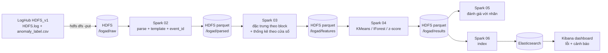

# 6. Kiến trúc và luồng dữ liệu

## Thành phần
| Thành phần | Vai trò | Cổng UI |
|---|---|---|
| HDFS (namenode + datanode) | Lưu log thô và parquet từng bước | http://localhost:9870 |
| Spark (master + worker) | Parse, đặc trưng, huấn luyện | http://localhost:8080 |
| Elasticsearch | Lưu/truy vấn kết quả | http://localhost:9200 |
| Kibana | Dashboard | http://localhost:5601 |

## Quy ước dữ liệu
| Bảng (parquet) | Khóa | Cột chính |
|---|---|---|
| `parsed` | – | ts, pid, level, component, content, template, event_id, block_id |
| `features` | block_id | vector đếm event, tổng dòng, #event khác nhau, #WARN/#ERROR, duration |
| `results/<model>` | block_id | anomaly_score, is_anomaly |
| `features_window_stats` | window, component, level | count |

## Quyết định thiết kế (điền lý do khi hoàn thành)
- **Vì sao Spark thay vì pandas?** 11M dòng + groupBy/pivot lớn; đo thời gian để chứng minh.
- **Vì sao KMeans làm mô hình chính?** Có sẵn phân tán trong MLlib, đúng gợi ý "phân cụm" của đề tài.
- **Vì sao vừa HDFS vừa Elasticsearch?** HDFS cho lưu trữ/batch rẻ; ES cho truy vấn tương tác và Kibana.
